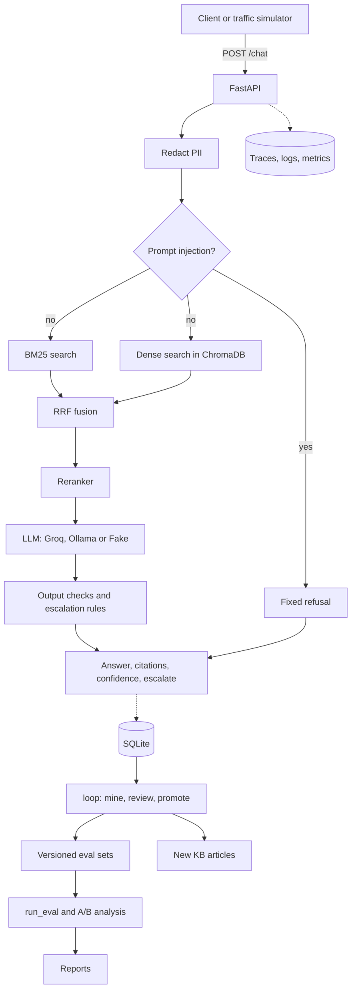

# SupportLoop: Design

Status: **approved 2026-11-25** (all proposed changes and defaults accepted). NovaPay is a fictional company.

## 1. Goals

A customer-support chatbot that:

1. Answers only from NovaPay help articles, and says which article it used.
2. Hands over to a human when it does not know.
3. Records what happens, so we can measure it.
4. Turns real failures into new test cases (the data loop).
5. Compares two versions fairly before choosing one (A/B testing).

**Not goals:** real customer accounts, actions such as freezing a card, a web UI, scaling beyond one machine, non-English support.

## 2. Constraints that shape the design

| Constraint | Effect |
|---|---|
| Groq free plan: 30 requests/min, 8K tokens/min, 1K requests/day, 200K tokens/day for each chat model ([docs](https://console.groq.com/docs/rate-limits), read 2026-11-25) | At about 2K tokens per call (assumed, to be measured) that is about **100 calls a day** per model. A full eval takes days, so every eval run must resume where it stopped. |
| 4 GB VRAM | Embedder, reranker and local LLM probably cannot all be on the GPU at once (to be measured). |
| 5.8 GB RAM visible to WSL | Loading both retrieval models on the CPU is tight. |
| Public GitHub repo | No secrets, no database, no caches in git. |

## 3. Architecture

## 4. Data flow for one request

1. **Validate** the input, including a length limit.
2. **Redact PII** first. Only the redacted text is stored, logged, traced, searched or sent to an LLM.
3. **Injection check.** Pattern rules. If it fires: fixed refusal, no LLM call.
4. **Retrieve.** BM25 (matches words) and dense search (matches meaning) each return 20 chunks. RRF merges the two lists using rank positions, so their different score scales do not matter. The reranker re-scores the merged top 20, and we keep 4.
5. **Generate.** The LLM must return JSON: `behavior` (answer, escalate or refuse), `answer`, `cited_article_ids`.
6. **Check the output in code.** Invalid JSON, a citation that was not retrieved, or an answer without a citation means we escalate. When unsure, we fail safely. A top reranker score below the threshold also escalates (unless the result is a refusal). Rules also escalate risky cases, such as fraud or "I want a human".
7. **Respond and record.**

All counts and thresholds above are starting values kept in config.

- **Confidence** is computed by our code from the top reranker score, and is 0 if an output check fails. We do not ask the LLM how confident it is. It is **not** a probability of being correct. Phase 2 tests how well it predicts correctness.
- **Follow-up questions:** the prompt gets the last few turns, and the search query includes the previous user message. This is simple and will miss some long conversations.
- **Chunking:** split at markdown headings, and add the article title to each chunk. Chunk ID is `article_id#heading-slug`, so editing one section does not renumber the others. Renaming a heading does change its ID.

## 5. Key design decisions

| Decision | Why, in plain words | Rejected |
|---|---|---|
| No LangChain or LlamaIndex | Every step is our own code, so it can be read and explained. | Frameworks: faster to start, but hide the logic. |
| Hybrid search plus reranker | Word search finds exact terms ("IBAN"). Meaning search finds rephrasings. The reranker reads question and chunk together. Phase 1 measures whether each part helps. | Dense only: kept as a baseline. |
| `bm25s` for BM25 | Maintained. `rank-bm25` has had no release since 2022. | `rank-bm25`. |
| ChromaDB inside the app | No extra server for a few hundred chunks. | Qdrant, pgvector: more to operate. |
| SQLite with SQLAlchemy | One file, no server, enough for one machine. | Postgres: needed for many concurrent writers. |
| One small LLM interface: Groq, Ollama, Fake | Swap models by config. Tests need no API key. | LiteLLM: another layer to explain. |
| Custom graders, no RAGAS | We control the rubric and can check the judge against a human. | RAGAS: more dependencies and more judge calls. |
| One judge call returns two verdicts (faithful, correct) | Uses fewer requests on the free plan. Risk: one verdict influences the other. Human review checks for this. | Two separate calls. |
| Cache key is a hash of the **whole request** (provider, model, full prompt with retrieved text, parameters, schema) | If an article changes, the prompt changes, so we cannot get an old answer back. | Key of (model, prompt version, user message): would break the data-loop before/after test. |
| Cache stores the first call's latency and tokens; off for live traffic | Reruns give the same numbers, and latency is never the time of a cache lookup. | Timing cached reruns. |
| OpenTelemetry GenAI attribute names kept in one file | These conventions are still marked "Development" and may be renamed. Message text is not put in traces. | Names scattered through the code. |
| CI also uses a fake embedder and fake reranker | CI stays fast and downloads no models. It tests wiring, **not answer quality**. | Real models in CI. |

## 6. Models

Candidates, all confirmed to exist on 2026-11-25. Choices are made from measurements, not from this table.

| Role | Candidates |
|---|---|
| Embedder | `Qwen/Qwen3-Embedding-0.6B`, `BAAI/bge-m3`, `BAAI/bge-small-en-v1.5` (small baseline: shows whether a big model is worth it) |
| Reranker | none (baseline), `Qwen/Qwen3-Reranker-0.6B`, `BAAI/bge-reranker-v2-m3` |
| Local LLM (Ollama) | `qwen3.5:2b` (2.7 GB download), `llama3.2:3b` (2.0 GB), `phi4-mini` (2.5 GB) |

`gemma4:e2b` is left out: its 4.6 GB download is larger than our VRAM. Download size is not VRAM use, so VRAM is measured for each candidate.

**Groq.** The `/models` endpoint confirmed on 2026-11-25 that our key can use `openai/gpt-oss-20b`, `openai/gpt-oss-120b` and `qwen/qwen3.8-27b`.

- Generator: `openai/gpt-oss-20b`.
- Judge: `qwen/qwen3.8-27b`, and **every report records the judge model**. A different model family avoids a model grading its own style, and spreads calls over two daily quotas. Risk: Groq lists it as "preview", so it can be withdrawn. Fallback: `openai/gpt-oss-120b`.

**How we choose**

- Retrieval: about 90 question to article pairs. **30 for choosing** models and thresholds, **60 held out** for the reported numbers. Choosing and reporting on the same questions makes results look better than they are. If candidates are too close to separate, we call it a tie and take the faster, smaller one.
- Local LLM: retrieval pairs cannot test text generation, so we add about 30 generation tasks. We measure valid JSON, correct behaviour, valid citations, tokens per second and VRAM.

## 7. What counts as a failure

A **failure candidate** is a turn worth a human look. It becomes a **confirmed failure** only after review.

| Signal | Rule |
|---|---|
| Escalation or "I don't know" | `escalate = true`. May be correct behaviour; still shows a possible KB gap. |
| Weak retrieval | Top reranker score below threshold. |
| Negative feedback | Thumbs down. |
| Guardrail | Injection detected or output check failed. PII redaction is counted but is **not** a failure on its own: it is the system working. |
| Unfaithful answer | Judge says "not supported" on a sample of live traffic. |
| System error | Timeout, provider error, unreadable output. |

## 8. Metrics

| Metric | Definition |
|---|---|
| Recall@5 | Share of expected articles found in the top 5 distinct articles, averaged over questions. |
| MRR | 1 / rank of the first correct article, averaged (0 if not found). |
| Behaviour accuracy | Share of tasks where answer / escalate / refuse matches the expected one. |
| Pass rate | Correct behaviour. Answered tasks must also pass citation, number and both judge checks. Multi-part tasks must cover every part. |
| Faithfulness | Share of answers judged fully supported by the retrieved text. |
| Citation accuracy | Share of answers where every citation was retrieved and at least one is an expected article. |
| Number check | Every number in an answer appears in a cited article or in the user's message. |
| Escalation precision / recall | Of our escalations, how many were expected / of expected escalations, how many we made. |
| Judge-human agreement | Percent agreement and Cohen's kappa (agreement beyond chance) on 30 random verdicts. If nearly all are "pass", percent agreement looks high even for a weak judge, so we show the full table. |
| Latency p50 / p95 | End to end, uncached calls only. Time spent waiting on rate limits is reported separately. |
| Tokens per answer | Input plus output, as reported by the provider. |

Eval metrics get 95% bootstrap confidence intervals (resample the tasks many times and see how much the number moves), with a fixed seed.

## 9. Data splits (stops us testing on what we tuned on)

Banking77 `test.csv` has 3,080 messages, 40 for each of 77 intents. A script with a fixed seed splits it into pools that never overlap:

| Pool | Use |
|---|---|
| Eval | Source of real phrasing for eval sets and retrieval pairs |
| Mining traffic | Replayed through the API; the data loop mines these |
| Loop holdout | Never mined; checks whether new articles help unseen messages |
| A/B traffic | Online experiments |

`train.csv` is not used for evaluation, because your Phase 3 intent model was trained on Banking77 training data. Banking77 is CC BY 4.0, so the repo will credit it.

**Two traps in the data loop**

1. If we write an article for a failure and then test on that same message, improvement is almost guaranteed. So we report the loop holdout separately.
2. We plant the KB gaps ourselves. Mining must not read intent labels. Afterwards we use the labels to report how many of the planted gaps it found, and how many "gaps" it reported that were not real.

**Planned gaps (10 intents):** `apple_pay_or_google_pay`, `get_disposable_virtual_card`, `disposable_card_limits`, `atm_support`, `card_swallowed`, `automatic_top_up`, `lost_or_stolen_phone`, `edit_personal_details`, `terminate_account`, `age_limit`. Covered articles must not accidentally answer these.

## 10. A/B method

**Written in the experiment YAML before running:** hypothesis, one primary metric, guardrail limits (p95 latency, escalation rate, tokens as the cost measure), traffic split, sample size.

**Assignment:** SHA-256 of `experiment_name:user_id` picks one of 10,000 buckets, and buckets map to variants. The same user always gets the same variant, and different experiments split users independently.

| Test | Design | Statistics |
|---|---|---|
| Offline | Both variants answer the same tasks | McNemar test (uses only tasks where the variants disagree) and bootstrap CI on the difference. Primary: pass rate. |
| Online (simulated) | Users are split between variants | Two-proportion test, bootstrap CI, guardrails. Primary: behaviour accuracy. |

- **One message per simulated user** in the online test. Messages from one user are not independent, and treating them as independent makes results look more certain than they are.
- Behaviour accuracy is automatic online only because simulated messages have known intents. **Real production traffic has no such labels.**
- **Sample ratio check:** if the real split differs too much from the planned one, the experiment is invalid.
- **No peeking:** `analyze.py` gives no decision before the planned sample is reached.

**Decision:** *ship* if the primary metric is significantly better and no guardrail is broken. *Don't ship* if it is significantly worse or a guardrail is broken. Otherwise *inconclusive*.

**What our sample sizes can detect** (planning estimates: normal approximation, 5% two-sided error, 80% power; not project results):

| Test | To detect | Needed |
|---|---|---|
| Online | 70% → 85% | 121 per variant |
| Online | 70% → 80% | 294 per variant |
| Online | 70% → 75% | 1,251 per variant |
| Offline paired | 10-point gain, variants disagree on 20% of tasks | 155 tasks |
| Offline paired | 5-point gain, variants disagree on 10% of tasks | 312 tasks |

So an eval set of about 150 tasks can only reliably detect **large** differences. "Inconclusive" is a likely and acceptable result.

## 11. Known risks

| Risk | Plan |
|---|---|
| Free-plan limits make runs take days | Cache, resumable batches, daily token budget in config, retry using the `retry-after` header. |
| GPU out of memory | Measure each model. With Groq, retrieval stays on the GPU. With Ollama, try retrieval on the CPU. If too slow, offline evals run in two stages (retrieve all, free the GPU, generate all). A live local-model API may stay slow. |
| Groq vs Ollama is not a clean comparison | Retrieval hardware and network differ, so latency is not like for like. Make prompt v1 vs v2 the first experiment. |
| KB, questions and judge are all AI-made | Scores may be too optimistic. Items are labelled `ai_drafted` until a human marks them reviewed; real Banking77 phrasing; human spot checks. |
| One reviewer | No measure of agreement between humans. State it as a limitation. |
| PII rules miss things | Rules cover cards, IBANs, emails and phones. **Not names or addresses.** |
| Injection rules are easy to get around | Also: no tools or secrets for the LLM to misuse, plus output checks. A model-based detector is a possible later comparison. |
| Rules or judge fail on text inside KB or user input | Treat both as data in the prompt; include injection tasks in the eval set. |
| Docker image with GPU libraries is very large | Decide in Phase 3; likely a CPU-only image. |
| No authentication on the API | Local demo only. Stated as a limitation. |

## 12. Phases

1. **Chatbot:** repo setup, KB, retrieval with model comparison, chat API with guardrails.
2. **Measure:** storage, feedback, metrics, traffic simulator, eval set v1, graders, human review.
3. **Improve and ship:** data loop, A/B test, optional intent routing, Docker, CI, README.
