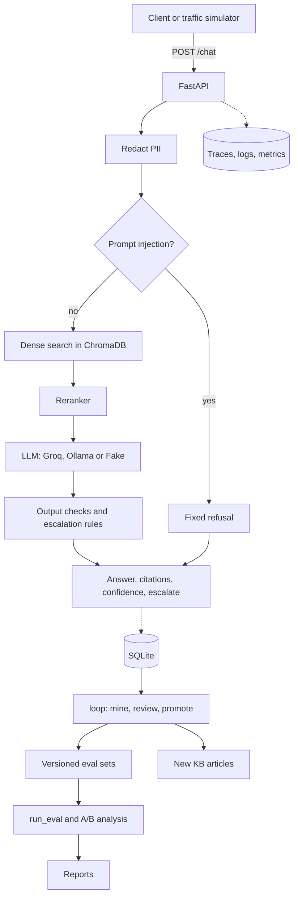

# SupportLoop: Design

Status: **approved 2026-11-25** (all proposed changes and defaults accepted). NovaPay is a fictional company.

## 1. Goals

A customer-support chatbot that:

1. Answers only from NovaPay help articles, and says which article it used.
2. Hands over to a human when it does not know.
3. Records what happens, so we can measure it.
4. Turns real failures into new test cases (the data loop).
5. Compares two versions fairly before choosing one (A/B testing).

**Not goals:** real customer accounts, actions such as freezing a card, a web UI, scaling beyond one machine, non-English support.

## 2. Constraints that shape the design

| Constraint | Effect |
|---|---|
| Groq free plan: 30 requests/min, 8K tokens/min, 1K requests/day, 200K tokens/day for each chat model ([docs](https://console.groq.com/docs/rate-limits), read 2026-11-25) | Measured in Phase 1: `openai/gpt-oss-20b` used on average 746 input and 85 output tokens per call on 30 tasks without chat history (`reports/raw/benchmark_llm.json`), so about **240 calls a day** from the token limit. Large runs must still be resumable. (The first plan assumed 2K tokens per call.) |
| 4 GB VRAM | Retrieval models (about 1.2 GB) plus the local LLM (about 2.4 GB plus driver overhead) leave no safe margin, so with Ollama the retrieval models run on the CPU. |
| WSL RAM: 5.8 GB, raised to 10 GB in `.wslconfig` (applies after a WSL restart) | Phase 1 measurements were taken with 5.8 GB. |
| Public GitHub repo | No secrets, no database, no caches in git. |

## 3. Architecture

## 4. Data flow for one request

1. **Validate** the input, including a length limit.
2. **Redact PII** first. Only the redacted text is stored, logged, traced, searched or sent to an LLM.
3. **Injection check.** Pattern rules. If it fires: fixed refusal, no LLM call.
4. **Retrieve.** Dense search (matches meaning) returns 20 chunks. The reranker re-scores them, and we keep 4. BM25 plus RRF fusion was removed from the live path after Phase 1 (section 6.3). It can be switched back on with `retrieval_mode: hybrid`.
5. **Generate.** The LLM must return JSON: `behavior` (answer, escalate or refuse), `answer`, `cited_article_ids`.
6. **Check the output in code.** Invalid JSON, a citation that was not retrieved, an answer without a citation, or a number that no cited article supports means we escalate (an amount of money or a percentage must appear as such in a cited article). If retrieval or the LLM fails, we also hand off. When unsure, we fail safely. A top reranker score below the threshold also escalates (unless the result is a refusal). Rules also escalate risky cases, such as fraud or "I want a human".
7. **Respond and record.**

All counts and thresholds above are starting values kept in config.

- **Confidence** is computed by our code from the top reranker score, and is 0 if an output check fails. We do not ask the LLM how confident it is. It is **not** a probability of being correct. Phase 2 tests how well it predicts correctness.
- **Follow-up questions:** the prompt gets the last few turns, and the search query includes the previous user message. This is simple and will miss some long conversations.
- **Chunking:** split at markdown headings, and add the article title to each chunk. Chunk ID is `article_id#heading-slug`, so editing one section does not renumber the others. Renaming a heading does change its ID.

## 5. Key design decisions

| Decision | Why, in plain words | Rejected |
|---|---|---|
| No LangChain or LlamaIndex | Every step is our own code, so it can be read and explained. | Frameworks: faster to start, but hide the logic. |
| Dense search plus reranker (was: hybrid) | Dense search finds rephrasings; the reranker reads question and chunk together. BM25 was planned and measured, then dropped because it added nothing measurable (6.3). | BM25 + RRF hybrid: kept in code for comparison. Dense without reranker: scored about the same on test, but then there is no tested score for the escalation threshold. |
| `bm25s` for BM25 (comparison only) | Maintained. `rank-bm25` has had no release since 2022. | `rank-bm25`. |
| ChromaDB inside the app | No extra server for a few hundred chunks. | Qdrant, pgvector: more to operate. |
| SQLite with SQLAlchemy | One file, no server, enough for one machine. | Postgres: needed for many concurrent writers. |
| One small LLM interface: Groq, Ollama, Fake | Swap models by config. Tests need no API key. | LiteLLM: another layer to explain. |
| Custom graders, no RAGAS | We control the rubric and can check the judge against a human. | RAGAS: more dependencies and more judge calls. |
| One judge call returns two verdicts (faithful, correct) | Uses fewer requests on the free plan. Risk: one verdict influences the other. Human review checks for this. | Two separate calls. |
| Cache key is a hash of the **whole request** (provider, model, full prompt with retrieved text, parameters, schema) | If an article changes, the prompt changes, so we cannot get an old answer back. | Key of (model, prompt version, user message): would break the data-loop before/after test. |
| Cache stores the first call's latency and tokens; off for live traffic | Reruns give the same numbers, and latency is never the time of a cache lookup. | Timing cached reruns. |
| OpenTelemetry GenAI attribute names kept in one file (tracing is built in Phase 2) | These conventions are still marked "Development" and may be renamed. Message text is not put in traces. | Names scattered through the code. |
| No tool or function calling: the bot cannot act on accounts, so a single JSON reply is enough | Fewer moving parts and nothing for an injection to trigger. | Tool calling: adds risk without a use here. |
| CI also uses a fake embedder and fake reranker | CI stays fast and downloads no models. It tests wiring, **not answer quality**. | Real models in CI. |

## 6. Models

Candidates, all confirmed to exist on 2026-11-25. Choices are made from measurements, not from this table.

| Role | Candidates |
|---|---|
| Embedder | `Qwen/Qwen3-Embedding-0.6B`, `BAAI/bge-m3`, `BAAI/bge-small-en-v1.5` (small baseline: shows whether a big model is worth it) |
| Reranker | none (baseline), `Qwen/Qwen3-Reranker-0.6B`, `BAAI/bge-reranker-v2-m3` |
| Local LLM (Ollama) | `qwen3.5:2b` (2.7 GB download), `llama3.2:3b` (2.0 GB), `phi4-mini` (2.5 GB) |

`gemma4:e2b` is left out: its 4.6 GB download is larger than our VRAM. Download size is not VRAM use, so VRAM is measured for each candidate.

**Groq.** The `/models` endpoint confirmed on 2026-11-25 that our key can use `openai/gpt-oss-20b`, `openai/gpt-oss-120b` and `qwen/qwen3.8-27b`.

- Generator: `openai/gpt-oss-20b`.
- Judge: `qwen/qwen3.8-27b`, and **every report records the judge model**. A different model family avoids a model grading its own style, and spreads calls over two daily quotas. Risk: Groq lists it as "preview", so it can be withdrawn. Fallback: `openai/gpt-oss-120b`.

**How we choose** (rules written in `config/benchmark.yaml` before the first run)

- Retrieval: 90 question to article pairs. **30 (dev) for choosing** models and the threshold, **60 (test) held out** for reported numbers. Among candidates within one dev question of the best on both Recall@5 and MRR, take the fastest.
- Local LLM: 30 tasks drawn from the dev pairs, using real retrieved context. Highest pass rate; near-ties go to the faster model.

### 6.1 First selection, with hybrid search (dev split, 2026-11-25)

From `reports/raw/benchmark_retrieval_hybrid.json`. Latency changed noticeably between runs, so treat it as rough.

| Embedder | Reranker | Recall@5 | MRR | p50 ms | VRAM MiB |
|---|---|---|---|---|---|
| Qwen3-Embedding-0.6B | none | 0.967 | 0.766 | 51 | 1204 |
| Qwen3-Embedding-0.6B | Qwen3-Reranker-0.6B | 0.967 | 0.842 | 480 | 2350 |
| Qwen3-Embedding-0.6B | bge-reranker-v2-m3 | 1.000 | 0.928 | 181 | 2306 |
| bge-m3 | none | 0.967 | 0.754 | 24 | 1140 |
| bge-m3 | Qwen3-Reranker-0.6B | 0.967 | 0.840 | 450 | 2284 |
| bge-m3 | bge-reranker-v2-m3 | 1.000 | 0.928 | 154 | 2232 |
| bge-small-en-v1.5 | none | 0.933 | 0.719 | 14 | 106 |
| bge-small-en-v1.5 | Qwen3-Reranker-0.6B | 1.000 | 0.843 | 442 | 1246 |
| bge-small-en-v1.5 | bge-reranker-v2-m3 **(chosen)** | 1.000 | 0.928 | 138 | 1196 |

**Choice: `bge-small-en-v1.5` + `bge-reranker-v2-m3`.** With `bge-reranker-v2-m3`, all three embedders gave identical dev scores, and the small one used about half the VRAM. The reranker mattered more than the embedder.

**What the held-out test split showed:** the chosen pipeline scored clearly lower than on dev, and it was **not measurably better than dense search alone**.

### 6.2 Results: local LLM (30 tasks, 2026-11-25)

From `reports/retrieval_v1.md`, which also shows what kind of mistakes each model made.

| Model | Pass | p50 s | VRAM GiB |
|---|---|---|---|
| qwen3.5:2b | 16/30 | 1.2 | 2.19 |
| llama3.2:3b **(chosen local)** | 21/30 | 1.5 | 2.38 |
| phi4-mini | 20/30 | 1.8 | 2.88 |
| openai/gpt-oss-20b (hosted reference) | 26/30 | 0.6 | hosted |

Rerun with dense-retrieval context. One task (`ret-098`) failed for every model because retrieval no longer returns its article.

**Choice: `llama3.2:3b`**, by the pre-declared rule, **now only just**: `phi4-mini` is one task behind, which the rule counts as a tie, so latency decides. **Trade-off:** `llama3.2:3b` answered 3 times when it should have handed off or refused; `phi4-mini` and `qwen3.5:2b` never did (they handed off too often instead). For a fintech that risk matters, and choosing `phi4-mini` for safety would be defensible. The app's retrieval threshold catches some such cases, not necessarily all.

All three local models run fully on the GPU only with `num_gpu: 99`; Ollama's automatic placement kept part of each on the CPU.

### 6.3 Dropping BM25 (after the Phase 1 review)

**Question:** does BM25 earn its place? **Rule, committed before measuring:** use dense + reranker if its mean is at most 0.034 below hybrid + reranker on both Recall@5 and MRR on the test split.

**Result:** on 60 test questions the gaps were Recall@5 +0.000 and MRR -0.003, both with intervals that include zero (`reports/retrieval_v1.md`). A tie, so the app now uses **dense + reranker**.

- **Why drop on a tie:** with equal measured quality, fewer parts means less to explain, debug and keep in step. It does **not** make search noticeably faster: the reranker takes almost all the time.
- **What could be lost:** BM25 is good at exact terms (codes, product names). Our questions rarely depend on them. On a larger or more technical knowledge base, measure again.
- **Caveat:** this choice was made on the test split, so that split is no longer unseen for it, and a tie on 60 questions is not proof of equality. Phase 2's new eval questions give a fresh check.

**Fresh check (Phase 2):** on 97 answerable inputs from eval set v1, which played no part in any decision, dense + reranker scored Recall@5 0.959 and hybrid + reranker 0.948 (paired difference +0.010, interval -0.021 to +0.041). The decision held up.

**Knock-on 1: embedder re-checked in dense mode** (dev split, same rule). Without BM25 as a second source, the embedder matters more.

| Embedder | Reranker | Recall@5 | MRR | p50 ms | VRAM MiB |
|---|---|---|---|---|---|
| Qwen3-Embedding-0.6B | none | 0.933 | 0.878 | 59 | 1204 |
| Qwen3-Embedding-0.6B | Qwen3-Reranker-0.6B | 0.967 | 0.834 | 502 | 2350 |
| Qwen3-Embedding-0.6B | bge-reranker-v2-m3 | 0.967 | 0.911 | 183 | 2306 |
| bge-m3 | none | 1.000 | 0.872 | 30 | 1140 |
| bge-m3 | Qwen3-Reranker-0.6B | 1.000 | 0.841 | 487 | 2284 |
| bge-m3 | bge-reranker-v2-m3 | 1.000 | 0.928 | 160 | 2232 |
| bge-small-en-v1.5 | none | 0.933 | 0.853 | 13 | 106 |
| bge-small-en-v1.5 | Qwen3-Reranker-0.6B | 0.933 | 0.807 | 468 | 1246 |
| bge-small-en-v1.5 | bge-reranker-v2-m3 **(chosen)** | 0.967 | 0.894 | 145 | 1196 |

The rule still picks `bge-small-en-v1.5` + `bge-reranker-v2-m3`, **but only just**: `bge-m3` with the same reranker scored higher (1.000 / 0.928 against 0.967 / 0.894). The whole difference is **one dev question** (`ret-098`), and the tie margin was defined as about one question. `bge-m3` used about twice the VRAM.

**Knock-on 2: escalation threshold recalibrated** from 0.0311 to **0.0049** (a reranker score depends on which chunks it is given, and the calibration rule was re-applied). On test it now wrongly escalates 5 of 60 answerable questions and catches 8 of 10 unanswerable banking and 10 of 10 off-topic ones. Before the switch it was 7 of 60, 10 of 10 and 10 of 10. So fewer needless hand-offs, but two unanswerable banking questions now depend on the LLM to hand off. The value is fragile: it rests on one or two of the 30 dev scores.

This also fixed a Phase 1 bug: the threshold was rounded to the nearest 4 decimals, which could round up past the boundary question and break the 5% limit (Phase 1 had 2 of 30 on dev instead of 1). It is now rounded down.

## 7. What counts as a failure

A **failure candidate** is a turn worth a human look. It becomes a **confirmed failure** only after review.

| Signal | Rule |
|---|---|
| Escalation or "I don't know" | `escalate = true`. May be correct behaviour; still shows a possible KB gap. |
| Weak retrieval | Top reranker score below threshold. |
| Negative feedback | Thumbs down. |
| Guardrail | Injection detected, output check failed, or out-of-scope refusal (so that wrong refusals of real banking questions reach a reviewer). PII redaction is counted but is **not** a failure on its own: it is the system working. |
| Unfaithful answer | Judge says "not supported" on a sample of live traffic. |
| System error | Timeout, provider error, unreadable output. |

## 8. Metrics

| Metric | Definition |
|---|---|
| Recall@5 | Share of expected articles found in the top 5 distinct articles, averaged over questions. |
| MRR | 1 / rank of the first correct article, averaged (0 if not found). |
| Behaviour accuracy | Share of tasks where answer / escalate / refuse matches the expected one. |
| Pass rate | Correct behaviour. Answered tasks must also pass citation, number and both judge checks. Multi-part tasks must cover every part. |
| Faithfulness | Share of answers judged fully supported by the retrieved text. |
| Citation accuracy | Share of answers where every citation was retrieved and at least one is an expected article. |
| Number check | Every number in an answer appears in a cited article or in the user's message. |
| Escalation precision / recall | Of our escalations, how many were expected / of expected escalations, how many we made. |
| Judge-human agreement | Percent agreement and Cohen's kappa (agreement beyond chance) on 30 random verdicts. The person answers **before** seeing the judge's verdict, so it cannot sway them. If nearly all are "pass", percent agreement looks high even for a weak judge, so we show the full table. |
| Latency p50 / p95 | End to end, uncached calls only. Time spent waiting on rate limits is reported separately. |
| Tokens per answer | Input plus output, as reported by the provider. |

Eval metrics get 95% bootstrap confidence intervals (resample the tasks many times and see how much the number moves), with a fixed seed.

### 8.1 How production signals are recorded (built in Phase 2)

| Piece | Design | Why |
|---|---|---|
| Storage | The API writes one row per turn after the reply is made: redacted message, chunk IDs and scores, the article text shown, redacted model reply, decision, versions, latency and tokens. If the write fails, the customer still gets the reply and an error is counted. | Everything needed to explain or re-judge a reply, even after the knowledge base changes. |
| Evals | Call the pipeline directly, never the API | Test traffic cannot pollute production data or metrics. |
| Simulator | Intent labels go to `data/sim/`, never to the API or database | Mining must not see which topics are planted gaps. |
| Metrics | Counters and a latency histogram by model and variant; no user or request IDs as labels. Escalation rate is a PromQL ratio. | High-cardinality labels overload Prometheus. Counters reset on restart; the database is the permanent record. One worker process only. |
| Traces | One trace per turn: input guardrail, retrieval, LLM call, output guardrail. GenAI attribute names in `app/observability/semconv.py`. No message, query or answer text. Written to `logs/traces.jsonl`, or sent by OTLP. | The conventions are still in "Development". Text in traces is a second copy of customer data. |

## 9. Data splits (stops us testing on what we tuned on)

Banking77 `test.csv` has 3,080 messages, 40 for each of 77 intents. A script with a fixed seed splits it into pools that never overlap:

| Pool | Use |
|---|---|
| Eval | Source of real phrasing for eval sets and retrieval pairs |
| Mining traffic | Replayed through the API; the data loop mines these |
| Loop holdout | Never mined; checks whether new articles help unseen messages |
| A/B traffic | Online experiments |

`train.csv` is not used for evaluation, because your Phase 3 intent model was trained on Banking77 training data. Banking77 is CC BY 4.0, so the repo will credit it.

**Two traps in the data loop**

1. If we write an article for a failure and then test on that same message, improvement is almost guaranteed. So we report the loop holdout separately.
2. We plant the KB gaps ourselves. Mining must not read intent labels. Afterwards we use the labels to report how many of the planted gaps it found, and how many "gaps" it reported that were not real.

**Planned gaps (10 intents):** `apple_pay_or_google_pay`, `get_disposable_virtual_card`, `disposable_card_limits`, `atm_support`, `card_swallowed`, `automatic_top_up`, `lost_or_stolen_phone`, `edit_personal_details`, `terminate_account`, `age_limit`. Covered articles must not accidentally answer these.

## 10. A/B method

**Written in the experiment YAML before running:** hypothesis, one primary metric, guardrail limits (p95 latency, escalation rate, tokens as the cost measure), traffic split, sample size.

**Assignment:** SHA-256 of `experiment_name:user_id` picks one of 10,000 buckets, and buckets map to variants. The same user always gets the same variant, and different experiments split users independently.

| Test | Design | Statistics |
|---|---|---|
| Offline | Both variants answer the same tasks | McNemar test (uses only tasks where the variants disagree) and bootstrap CI on the difference. Primary: pass rate. |
| Online (simulated) | Users are split between variants | Two-proportion test, bootstrap CI, guardrails. Primary: behaviour accuracy. |

- **One message per simulated user** in the online test. Messages from one user are not independent, and treating them as independent makes results look more certain than they are.
- Behaviour accuracy is automatic online only because simulated messages have known intents. **Real production traffic has no such labels.**
- **Sample ratio check:** if the real split differs too much from the planned one, the experiment is invalid.
- **No peeking:** `analyze.py` gives no decision before the planned sample is reached.

**Decision:** *ship* if the primary metric is significantly better and no guardrail is broken. *Don't ship* if it is significantly worse or a guardrail is broken. Otherwise *inconclusive*.

**What our sample sizes can detect** (planning estimates: normal approximation, 5% two-sided error, 80% power; not project results):

| Test | To detect | Needed |
|---|---|---|
| Online | 70% → 85% | 121 per variant |
| Online | 70% → 80% | 294 per variant |
| Online | 70% → 75% | 1,251 per variant |
| Offline paired | 10-point gain, variants disagree on 20% of tasks | 155 tasks |
| Offline paired | 5-point gain, variants disagree on 10% of tasks | 312 tasks |

So an eval set of about 150 tasks can only reliably detect **large** differences. "Inconclusive" is a likely and acceptable result.

## 11. Known risks

| Risk | Plan |
|---|---|
| Free-plan limits make runs take days | Cache, resumable batches, daily token budget in config, retry using the `retry-after` header. |
| GPU out of memory | Measure each model. With Groq, retrieval stays on the GPU. With Ollama, try retrieval on the CPU. If too slow, offline evals run in two stages (retrieve all, free the GPU, generate all). A live local-model API may stay slow. |
| Groq vs Ollama is not a clean comparison | Retrieval hardware and network differ, so latency is not like for like. Make prompt v1 vs v2 the first experiment. |
| **Observed in Phase 2:** real numbers attached to the wrong thing | The local model told simulated customers of fees that do not exist; the number check passed them. The judge on live samples caught them after the fact. Candidates for Phase 3: a prompt change, a different local model, or a check that ties each amount to its sentence in the source. |
| KB, questions and judge are all AI-made | Scores may be too optimistic. Items are labelled `ai_drafted` until a human marks them reviewed; real Banking77 phrasing; human spot checks. |
| One reviewer | No measure of agreement between humans. State it as a limitation. |
| PII rules miss things | Rules cover cards, IBANs, emails and phones. **Not names or addresses.** |
| Injection rules are easy to get around | Also: no tools or secrets for the LLM to misuse, plus output checks. A model-based detector is a possible later comparison. |
| Rules or judge fail on text inside KB or user input | Treat both as data in the prompt; include injection tasks in the eval set. |
| Docker image with GPU libraries is very large | Decide in Phase 3; likely a CPU-only image. |
| No authentication on the API | Local demo only. Stated as a limitation. |

## 12. Phases

1. **Chatbot:** repo setup, KB, retrieval with model comparison, chat API with guardrails.
2. **Measure:** storage, feedback, metrics, traffic simulator, eval set v1, graders, human review.
3. **Improve and ship:** data loop, A/B test, optional intent routing, Docker, CI, README.
