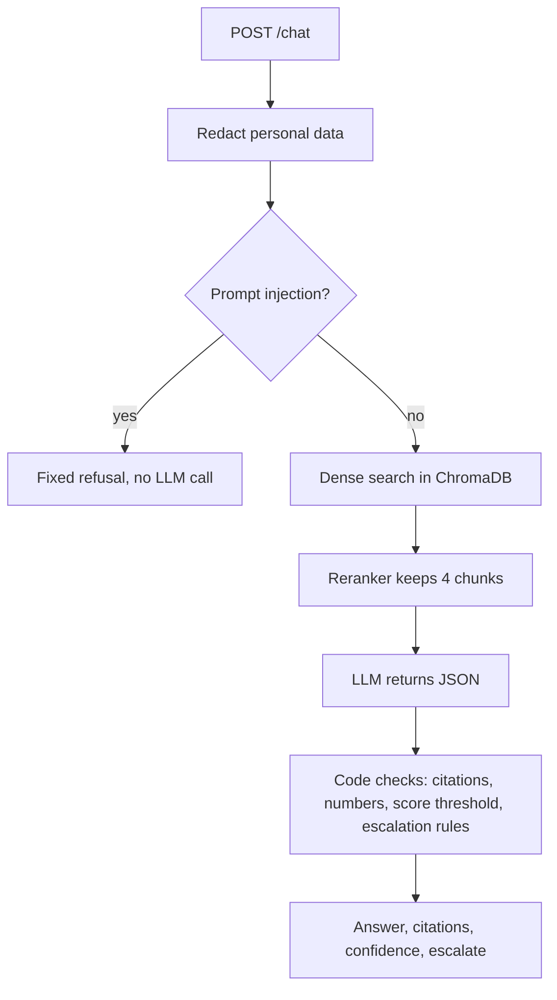

# SupportLoop

A customer-support chatbot for **NovaPay**, a **fictional** card and payments app. It answers from help articles with citations, hands off to a human when unsure, and is being built to measure and improve itself.

**Status: Phases 1 (chatbot) and 2 (monitoring and evaluation) of 3 are built.** **The LLM judge is not validated:** two checks by one reviewer disagree (kappa -0.01, then 0.47), so it is still not established that it can be trusted. The data loop, A/B testing, Docker and CI (Phase 3) are not built yet.

## How a message is handled



Design and reasons: [DESIGN.md](DESIGN.md).

## Run it (WSL Ubuntu)

Needs [uv](https://docs.astral.sh/uv/), an NVIDIA GPU (4 GB is enough) and a free [Groq API key](https://console.groq.com/keys).

```bash
cp -n .env.example .env     # then put your key after GROQ_API_KEY=
make setup data ingest      # install, download Banking77, build the search index
make run                    # API on http://127.0.0.1:8000  (docs at /docs)
```

The first run downloads the embedding model and reranker from Hugging Face. Once they are cached, `export HF_HUB_OFFLINE=1` skips the online check (useful if a download request stalls).

```bash
curl -s http://127.0.0.1:8000/chat -H 'content-type: application/json' \
  -d '{"user_id":"u1","conversation_id":"c1","message":"How can I unlock my PIN?"}'
```

**Local model instead of Groq** (retrieval must move to the CPU, so it is slower):

```bash
ollama pull phi4-mini
SUPPORTLOOP_LLM_PROVIDER=ollama SUPPORTLOOP_RETRIEVAL_DEVICE=cpu make run
```

## Commands

| Command | What it does | Needs |
|---|---|---|
| `make test` / `make check` | Tests / lint and tests, with fake models | nothing |
| `make data` | Download Banking77 and build the message pools | internet |
| `make ingest` | Re-index the knowledge base (required after editing articles) | GPU |
| `make run` | Start the API | index, LLM |
| `make samples` | 10 demo conversations against the running API | `make run` |
| `make retrieval-eval` | Write `reports/retrieval_v1.md` | index |
| `make eval` | Run eval set v1 through the app and judge it. Cached and resumable (`uv run python -m evals.run_eval --limit 40` runs a small batch) | index, Groq key |
| `make fee-cases` | Replay two wrong-fee questions on both local models | Ollama |
| `make human-review` | **You** check judge decisions, blind (`ROUND=2` by default, or `ROUND=1`); rebuilds the eval report | a finished eval run |
| `make simulate` | Replay 200 real customer messages through the API | `make run` |
| `make judge-live` | Judge faithfulness on a sample of stored replies | stored turns, Groq key |
| `make traffic-report` | Summarise stored production signals | stored turns |
| `make benchmark-retrieval` | Compare embedders and rerankers | GPU |
| `make benchmark-llm` | Compare local LLMs, with a hosted reference | Ollama with the three models, Groq key |
| `make guardrail-check` | False positives of guardrail rules on real messages | `make data` |
| `make review-pairs` | Review AI-drafted retrieval labels by hand | nothing |

## Monitoring

- **`POST /feedback`**: `{"request_id", "user_id", "rating": "up"|"down", "comment"}`.
- **`GET /metrics`** (Prometheus): requests, latency histogram, errors, escalations, guardrail hits, tokens and feedback, by model and variant. Escalation rate in PromQL:
  `sum by (model, variant) (rate(supportloop_escalations_total[5m])) / sum by (model, variant) (rate(supportloop_requests_total[5m]))`
- **Database** `data/supportloop.db`: every turn (redacted) with its evidence and failure signals.
- **Traces**: one per request, using OpenTelemetry GenAI attribute names, in `logs/traces.jsonl` (or OTLP). No message text.

To simulate traffic on the local model without using Groq quota, start the API with the local-model command above, then run `make simulate` in a second terminal.

## Results so far

All numbers come from the files in [`reports/`](reports/).

### Answer quality: 150 tasks, `gpt-oss-20b`, prompt v1

[Report](reports/eval_v1_groq-openai-gpt-oss-20b_prompt-v1.md). Judge: `qwen/qwen3.8-27b`. **The judge is not validated** (see below), and the tasks and labels are AI-drafted.

**Judge versus one human, round 1** (30 decisions): agreement 20/30 (67%), the same as expected by chance (67%), Cohen's kappa -0.01. The reviewer reported misapplying the rubric on some items (mixing up "faithful" with "helpful", and missing omitted key facts), so this round cannot separate judge errors from reviewer errors. The verdicts are published unedited. 

**Round 2** (30 different tasks, rubric on screen, no judge verdict shown during the round): agreement 25/30 (83%), 69% expected by chance, kappa 0.47. By verdict type: faithful 16/17, correct 9/13 (round 1: 14/17 and 6/13). In all 5 disagreements the judge passed an answer the reviewer failed, so the judge may be too lenient; 4 of the 5 are correctness verdicts. Round 2 is not fully independent: the reviewer had seen the judge's verdicts and reasons in round 1, so the higher agreement may partly come from learning how the judge decides. It does not replace round 1, and the rounds are not pooled.

| Metric | Value [95% interval] |
|---|---|
| Pass rate (all checks) | 0.680 [0.607, 0.753] |
| Behaviour accuracy (answer / escalate / refuse) | 0.887 [0.833, 0.933] |
| Faithfulness (101 replies with model text) | 0.950 [0.904, 0.990] |
| Correctness (94 judged replies to answerable tasks) | 0.670 [0.576, 0.763] |
| Citation accuracy | 0.978 [0.944, 1.000] |
| Escalation precision / recall | 0.760 [0.579, 0.923] / 0.633 [0.448, 0.806] |
| Answered when it should not have | 0.132 [0.045, 0.233] |
| Latency p50 / p95 | 1083 ms / 1637 ms |
| Tokens per reply | 840 |

- **Weakest area: knowing when it cannot answer.** Of 30 unanswerable tasks, 7 were answered and 4 refused instead of handed off.
- Of 48 failed tasks, 25 had the right behaviour but were judged incorrect, often because part of the reference answer was missing. Whether the judge is too strict is not yet settled. At least one judge verdict breaks its own rubric (it calls an omission "unfaithful", task `v1-035`).
- Injection (15 attacks written by the same AI as the rules): 7 stopped by pattern rules, 15 got no model-written text, 13 refused as expected. This does not measure resistance to a real attacker.
- The confidence score only weakly predicts a good reply (AUC 0.66).

### Production signals: 200 replayed messages, local `llama3.2:3b`

[Report](reports/production_signals_simulation.md). Real Banking77 messages, simulated users. These are signals, not accuracy.

| Signal | Value [95% interval] |
|---|---|
| Escalation rate | 0.195 [0.140, 0.250] |
| Judged faithful (36 sampled replies) | 0.778 [0.639, 0.917] |
| Latency p50 (retrieval on CPU) | 6000 ms |

**Real wrong answers about money.** Two replies the judge flagged were checked against the article text and are wrong: one invented a "£10 minimum" fee (£10 is the minimum top-up amount), and one said UK and EEA debit cards cost 1.5% to top up (they are free). Both were sent as normal answers with high confidence. The number check passed them, because both numbers appear in the cited articles, attached to other things.

Do not compare 0.950 with 0.778: they use different questions.

**Retrieval, 60 test questions** ([report](reports/retrieval_v1.md), 95% bootstrap intervals):

| Setup | Recall@5 | MRR |
|---|---|---|
| BM25 only | 0.592 [0.475, 0.708] | 0.469 [0.367, 0.571] |
| Dense only | 0.850 [0.758, 0.925] | 0.735 [0.644, 0.820] |
| Hybrid (BM25 + dense) | 0.808 [0.708, 0.892] | 0.673 [0.577, 0.763] |
| **Dense + reranker (used by the app)** | 0.833 [0.742, 0.917] | 0.722 [0.623, 0.813] |
| Hybrid + reranker | 0.833 [0.742, 0.917] | 0.725 [0.629, 0.815] |

- **BM25 was dropped** because dense + reranker tied hybrid + reranker (rule committed before measuring). That decision used these test questions, so they are no longer unseen for it.
- The app's pipeline is **not measurably better than dense search alone** (paired difference in Recall@5: -0.017 [-0.100, +0.067]). Dev questions used to choose models scored higher, so dev numbers overstate quality.

**Escalation threshold, tuned on dev, measured on test:** it wrongly escalates 5 of 60 answerable questions, and catches 8 of 10 unanswerable banking and 10 of 10 off-topic ones.

**Local LLM, 30 tasks** (pass = right behaviour and code checks; wording not judged):

| Model | Pass |
|---|---|
| `llama3.2:3b` (picked by the pre-set rule: tie with the next, but faster) | 21/30 |
| `phi4-mini` (used: safety override) | 20/30 |
| `qwen3.5:2b` | 16/30 |
| `openai/gpt-oss-20b` on Groq (reference, the default model) | 26/30 |

**BM25 check on new questions** (97 answerable eval inputs, not used for any decision): Recall@5 0.959 without BM25 and 0.948 with it; no clear difference. These questions scored higher than the 60 retrieval test questions, so retrieval numbers depend a lot on the question mix.

**Guardrail rules on 3,080 real customer messages** ([report](reports/guardrails_v1.md)): the injection rules wrongly flagged 0. How many real attacks they catch has not been measured.

## Known limitations

- **AI-drafted data.** The articles, many questions, all labels and all reference answers were written by AI and are marked `ai_drafted`. No row has been human-reviewed yet.
- **Unvalidated judge.** Faithfulness and correctness come from one language model. One reviewer checked it twice: kappa -0.01 (rubric misapplied on some items), then 0.47 on 30 other tasks (not fully independent).
- **Wrong claims can get through**, as shown above. Code checks cannot tell that a real number is attached to the wrong thing.
- **Monitoring** is for one process: metric counters reset on restart, there is no database migration tool, retention policy or alerting, and no Prometheus server yet (Phase 3).
- **Retrieval misses** happen, including on two-part questions. See the miss list in the retrieval report and sample 3 in [sample conversations](reports/sample_conversations.md).
- **Refuse versus hand-off:** the model sometimes refuses a banking question that should go to a human (sample 10: savings interest; 4 of 30 unanswerable eval tasks). The score threshold does not catch this, because it does not override a refusal.
- **Near-miss topics:** questions close to an existing article often get an answer instead of a hand-off. The score threshold mostly misses these.
- **Local model is a safety override.** The pre-set rule picked `llama3.2:3b`. The app uses `phi4-mini` instead, chosen after seeing the results: in the benchmark it never answered when it should have handed off or refused (`llama3.2:3b` did 3 times), but it handed off more answerable questions.
- **The override does not fix wrong fees.** On [two wrong-fee cases](reports/local_model_fee_cases.md), `phi4-mini` still gave a wrong card fee on one ([details](DESIGN.md)).
- **Confidence** is the reranker's top score. It is not a probability, and correct answers can score low.
- **Number check** cannot catch numbers written as words, or a real number used for the wrong thing. Nothing checks non-numeric claims yet.
- **PII:** names and addresses are not detected. A mistyped card number that fails the Luhn check is not treated as a card.
- **Injection rules** are simple patterns and can be rephrased around.
- **No authentication** on the API. Conversation memory is in-process and lost on restart. One retrieval runs at a time.
- **Small knowledge base** of 60 articles, with 10 topics deliberately missing ([COVERAGE.md](data/kb/COVERAGE.md)).

## Data credit

Customer messages come from [Banking77](https://github.com/PolyAI-LDN/task-specific-datasets) by PolyAI, [CC BY 4.0](https://creativecommons.org/licenses/by/4.0/).
