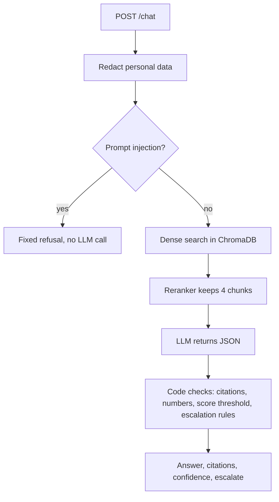

# SupportLoop

A customer-support chatbot for **NovaPay**, a **fictional** card and payments app. It answers from help articles with citations, hands off to a human when unsure, and is being built to measure and improve itself.

**Status: Phase 1 of 3 (chatbot) is built.** Monitoring and answer evaluation (Phase 2) and the data loop, A/B testing, Docker and CI (Phase 3) are not built yet.

## How a message is handled



Design and reasons: [DESIGN.md](DESIGN.md).

## Run it (WSL Ubuntu)

Needs [uv](https://docs.astral.sh/uv/), an NVIDIA GPU (4 GB is enough) and a free [Groq API key](https://console.groq.com/keys).

```bash
cp -n .env.example .env     # then put your key after GROQ_API_KEY=
make setup data ingest      # install, download Banking77, build the search index
make run                    # API on http://127.0.0.1:8000  (docs at /docs)
```

The first run downloads the embedding model and reranker from Hugging Face. Once they are cached, `export HF_HUB_OFFLINE=1` skips the online check (useful if a download request stalls).

```bash
curl -s http://127.0.0.1:8000/chat -H 'content-type: application/json' \
  -d '{"user_id":"u1","conversation_id":"c1","message":"How can I unlock my PIN?"}'
```

**Local model instead of Groq** (retrieval must move to the CPU, so it is slower):

```bash
ollama pull llama3.2:3b
SUPPORTLOOP_LLM_PROVIDER=ollama SUPPORTLOOP_RETRIEVAL_DEVICE=cpu make run
```

## Commands

| Command | What it does | Needs |
|---|---|---|
| `make test` / `make check` | Tests / lint and tests, with fake models | nothing |
| `make data` | Download Banking77 and build the message pools | internet |
| `make ingest` | Re-index the knowledge base (required after editing articles) | GPU |
| `make run` | Start the API | index, LLM |
| `make samples` | 10 demo conversations against the running API | `make run` |
| `make retrieval-eval` (or `make eval`) | Write `reports/retrieval_v1.md` | index |
| `make benchmark-retrieval` | Compare embedders and rerankers | GPU |
| `make benchmark-llm` | Compare local LLMs, with a hosted reference | Ollama with the three models, Groq key |
| `make guardrail-check` | False positives of guardrail rules on real messages | `make data` |
| `make review-pairs` | Review AI-drafted retrieval labels by hand | nothing |

## Results so far

All numbers come from the files in [`reports/`](reports/). **No result yet measures whether the bot's answers are correct**; that is Phase 2.

**Retrieval, 60 test questions** ([report](reports/retrieval_v1.md), 95% bootstrap intervals):

| Setup | Recall@5 | MRR |
|---|---|---|
| BM25 only | 0.592 [0.475, 0.708] | 0.469 [0.367, 0.571] |
| Dense only | 0.850 [0.758, 0.925] | 0.735 [0.644, 0.820] |
| Hybrid (BM25 + dense) | 0.808 [0.708, 0.892] | 0.673 [0.577, 0.763] |
| **Dense + reranker (used by the app)** | 0.833 [0.742, 0.917] | 0.722 [0.623, 0.813] |
| Hybrid + reranker | 0.833 [0.742, 0.917] | 0.725 [0.629, 0.815] |

- **BM25 was dropped** because dense + reranker tied hybrid + reranker (rule committed before measuring). That decision used these test questions, so they are no longer unseen for it.
- The app's pipeline is **not measurably better than dense search alone** (paired difference in Recall@5: -0.017 [-0.100, +0.067]). Dev questions used to choose models scored higher, so dev numbers overstate quality.

**Escalation threshold, tuned on dev, measured on test:** it wrongly escalates 5 of 60 answerable questions, and catches 8 of 10 unanswerable banking and 10 of 10 off-topic ones.

**Local LLM, 30 tasks** (pass = right behaviour and code checks; wording not judged):

| Model | Pass |
|---|---|
| `llama3.2:3b` (chosen: tie with the next, but faster) | 21/30 |
| `phi4-mini` | 20/30 |
| `qwen3.5:2b` | 16/30 |
| `openai/gpt-oss-20b` on Groq (reference, the default model) | 26/30 |

**Guardrail rules on 3,080 real customer messages** ([report](reports/guardrails_v1.md)): the injection rules wrongly flagged 0. How many real attacks they catch has not been measured.

## Known limitations

- **AI-drafted data.** The articles, many retrieval questions and all labels were written by AI and are marked `ai_drafted`. No row has been human-reviewed yet. Scores are likely optimistic.
- **Retrieval misses** happen, including on two-part questions. See the miss list in the retrieval report and sample 3 in [sample conversations](reports/sample_conversations.md).
- **Refuse versus hand-off:** the model sometimes refuses a banking question that should go to a human (sample 10: savings interest). The score threshold does not catch this, because it does not override a refusal.
- **`llama3.2:3b` trade-off:** in the benchmark it answered 3 times when it should have handed off or refused. `phi4-mini` never did, but handed off more answerable questions.
- **Confidence** is the reranker's top score. It is not a probability, and correct answers can score low.
- **Number check** cannot catch numbers written as words, or a real number used for the wrong thing. Nothing checks non-numeric claims yet.
- **PII:** names and addresses are not detected. A mistyped card number that fails the Luhn check is not treated as a card.
- **Injection rules** are simple patterns and can be rephrased around.
- **No authentication** on the API. Conversation memory is in-process and lost on restart. One retrieval runs at a time.
- **Small knowledge base** of 60 articles, with 10 topics deliberately missing ([COVERAGE.md](data/kb/COVERAGE.md)).

## Data credit

Customer messages come from [Banking77](https://github.com/PolyAI-LDN/task-specific-datasets) by PolyAI, [CC BY 4.0](https://creativecommons.org/licenses/by/4.0/).
