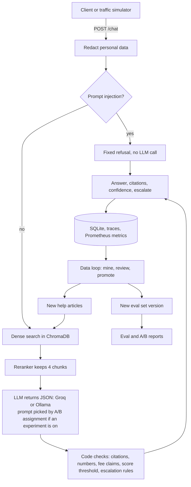

# SupportLoop

A support chatbot for **NovaPay**, a **fictional** card and payments app: it answers from help articles with citations and hands off to a human when unsure.
Around it: monitoring, evaluation, a data loop that turns logged failures into new articles, and A/B testing. Built with Claude Code.

> **Who checked what.** **The LLM judge is not validated** (one human round: kappa -0.06). Articles, tasks and labels are AI-drafted. In Phase 3, the data loop labels, the new articles, most fee-test labels and the remaining design decisions were made by **Claude Code and not reviewed by a human**.

## Architecture



Design and reasons: [DESIGN.md](DESIGN.md).

## Run it in 3 commands (Docker, no GPU needed)

Needs Docker with Compose and a free [Groq API key](https://console.groq.com/keys).

```bash
cp -n .env.example .env          # then put your key after GROQ_API_KEY=
docker compose up --build --wait # API on :8000 (docs at /docs), Prometheus on :9090
curl -s http://127.0.0.1:8000/chat -H 'content-type: application/json' -d '{"user_id":"u1","conversation_id":"c1","message":"How can I unlock my PIN?"}'
```

The first start downloads the search models, so it takes several minutes. Both ports listen on this machine only: the API has no authentication. For a local model:

```bash
SUPPORTLOOP_LLM_PROVIDER=ollama docker compose --profile ollama up --build -d
docker compose exec ollama ollama pull phi4-mini
```

The compose file was checked on one machine (WSL Ubuntu) with the Groq provider: both services started, one real chat answered with a citation, and Prometheus scraped without errors. The Ollama profile was not tested in Docker. The [CI workflow](.github/workflows/ci.yml) runs lint, tests with fake models and a small eval smoke test; its [first run on GitHub](https://github.com/alphindas/supportloop/actions/runs/45962939023) passed on 2026-11-27 (commit `7041a5d`: lint, 356 tests, 4 smoke tests). This checks wiring, not answer quality.

## Run it for development (WSL Ubuntu)

Needs [uv](https://docs.astral.sh/uv/), an NVIDIA GPU (4 GB is enough) and a Groq API key.

```bash
cp -n .env.example .env
make setup data ingest      # install, download Banking77, build the search index
make run                    # API on http://127.0.0.1:8000
```

The first run downloads the embedding model and reranker from Hugging Face. Once they are cached, `export HF_HUB_OFFLINE=1` skips the online check.

**Local model instead of Groq** (retrieval must move to the CPU, so it is slower):

```bash
ollama pull phi4-mini
SUPPORTLOOP_LLM_PROVIDER=ollama SUPPORTLOOP_RETRIEVAL_DEVICE=cpu make run
```

## Commands

| Command | What it does | Needs |
|---|---|---|
| `make test` / `make check` | Tests / lint and tests, with fake models | nothing |
| `make data` | Download Banking77 and build the message pools | internet |
| `make ingest` | Re-index the knowledge base (required after editing articles) | GPU |
| `make run` | Start the API | index, LLM |
| `make samples` | 10 demo conversations against the running API | `make run` |
| `make retrieval-eval` | Write `reports/retrieval_v1.md` | index |
| `make eval` | Run eval set v1 through the app and judge it. Cached and resumable (`uv run python -m evals.run_eval --limit 40` runs a small batch) | index, Groq key |
| `make fee-cases` | Replay two wrong-fee questions on both local models | Ollama |
| `make human-review` | Review tool for judge decisions, for a person only (round 3 by default); rebuilds the eval report. [Rounds 1 and 2 were done by a second AI](evals/human_review/README.md) | a finished eval run |
| `make simulate` | Replay 200 real customer messages through the API | `make run` |
| `make judge-live` | Judge faithfulness on a sample of stored replies | stored turns, Groq key |
| `make fee-check` | Old number check against the claim check | saved replies |
| `make loop-mine`, `loop-review`, `loop-promote` | Data loop: queue, labelling (for a person), next eval set | stored turns |
| `make loop-before`, `loop-holdout`, `loop-report` | Data loop before and after | Groq key (not for the report) |
| `make ab-analyze` | A/B report and decision | finished runs |
| `make traffic-report` | Summarise stored production signals | stored turns |
| `make benchmark-retrieval` | Compare embedders and rerankers | GPU |
| `make benchmark-llm` | Compare local LLMs, with a hosted reference | Ollama with the three models, Groq key |
| `make guardrail-check` | False positives of guardrail rules on real messages | `make data` |
| `make review-pairs` | Review AI-drafted retrieval labels by hand | nothing |

## Monitoring

- **`POST /feedback`**: `{"request_id", "user_id", "rating": "up"|"down", "comment"}`.
- **`GET /metrics`** (Prometheus): requests, latency histogram, errors, escalations, guardrail hits, tokens and feedback, by model and variant. Escalation rate in PromQL:
  `sum by (model, variant) (rate(supportloop_escalations_total[5m])) / sum by (model, variant) (rate(supportloop_requests_total[5m]))`
- **Database** `data/supportloop.db`: every turn (redacted) with its evidence and failure signals.
- **Traces**: one per request, using OpenTelemetry GenAI attribute names, in `logs/traces.jsonl` (or OTLP). No message text.

To simulate traffic on the local model without using Groq quota, start the API with the local-model command above, then run `make simulate` in a second terminal.

## Results so far

All numbers come from the files in [`reports/`](reports/).

### Answer quality: 150 tasks, `gpt-oss-20b`, prompt v1

[Report](reports/eval_v1_groq-openai-gpt-oss-20b_prompt-v1.md). Judge: `qwen/qwen3.8-27b`. **The judge is not validated** (see below), and the tasks and labels are AI-drafted.

**Judge review. The judge is not validated.** Each round used different tasks; rounds are not pooled.

| Round | Reviewer | Agreement with the judge | Expected by chance | Cohen's kappa | Faithful | Correct | Reviewer passed | Judge passed |
|---|---|---|---|---|---|---|---|---|
| 1 | second AI (ChatGPT) | 20/30 (67%) | 67% | -0.01 | 14/17 | 6/13 | 22/30 | 26/30 |
| 2 | second AI (ChatGPT) | 25/30 (83%) | 69% | 0.47 | 16/17 | 9/13 | 22/30 | 27/30 |
| 3 | one person (self-declared) | 20/30 (67%) | 69% | -0.06 | 14/15 | 6/15 | 29/30 | 21/30 |

**Round 3** is the only human check. The reviewer is the project owner, who states they used no AI help; the tool cannot verify this. Agreement 20/30 (67%), 69% expected by chance, Cohen's kappa -0.06: no better than chance. In 9 of the 10 disagreements the person passed an answer the judge failed (8 on correctness, 1 on faithfulness); in the other, the reverse. Who was right has not been checked. With only one "fail" from the person, kappa is unstable and the round says little about whether the judge catches bad answers. The owner had access to the eval report, which lists 13 of these 30 tasks as failed, often with the judge's reason; whether any of them looked familiar is not recorded.

**Rounds 1 and 2 were not human review.** The verdicts in both came from ChatGPT, not from a person, so this is AI-versus-AI agreement. Two models can share the same mistakes. The ChatGPT model version, the prompt and what it was shown are not recorded, so the verdicts cannot be reproduced and neither round can be called blind or independent. Both rounds were first published here as human review; **that was wrong** (corrected 2026-11-25), and some commit messages still say so. The verdict files are [unedited](evals/human_review/README.md).

**Second-AI round 1:** the rubric was reported as misapplied on some items (mixing up "faithful" with "helpful", and missing omitted key facts).

**Second-AI round 2:** in all 5 disagreements the judge passed an answer that ChatGPT failed; which of the two was right has not been checked. The reason for the higher agreement is unknown. It does not replace round 1, and the rounds are not pooled.

| Metric | Value [95% interval] |
|---|---|
| Pass rate (all checks) | 0.680 [0.607, 0.753] |
| Behaviour accuracy (answer / escalate / refuse) | 0.887 [0.833, 0.933] |
| Faithfulness (101 replies with model text) | 0.950 [0.904, 0.990] |
| Correctness (94 judged replies to answerable tasks) | 0.670 [0.576, 0.763] |
| Citation accuracy | 0.978 [0.944, 1.000] |
| Escalation precision / recall | 0.760 [0.579, 0.923] / 0.633 [0.448, 0.806] |
| Answered when it should not have | 0.132 [0.045, 0.233] |
| Latency p50 / p95 | 1083 ms / 1637 ms |
| Tokens per reply | 840 |

- **Weakest area: knowing when it cannot answer.** Of 30 unanswerable tasks, 7 were answered and 4 refused instead of handed off.
- Of 48 failed tasks, 25 had the right behaviour but were judged incorrect, often because part of the reference answer was missing. Whether the judge is too strict is not yet settled. At least one judge verdict breaks its own rubric (it calls an omission "unfaithful", task `v1-035`).
- Injection (15 attacks written by the same AI as the rules): 7 stopped by pattern rules, 15 got no model-written text, 13 refused as expected. This does not measure resistance to a real attacker.
- The confidence score only weakly predicts a good reply (AUC 0.66).

### Production signals: 200 replayed messages, local `llama3.2:3b`

[Report](reports/production_signals_simulation.md). Real Banking77 messages, simulated users. These are signals, not accuracy.

| Signal | Value [95% interval] |
|---|---|
| Escalation rate | 0.195 [0.140, 0.250] |
| Judged faithful (36 sampled replies) | 0.778 [0.639, 0.917] |
| Latency p50 (retrieval on CPU) | 6000 ms |

**Real wrong answers about money.** Two replies the judge flagged were checked against the article text and are wrong: one invented a "£10 minimum" fee (£10 is the minimum top-up amount), and one said UK and EEA debit cards cost 1.5% to top up (they are free). Both were sent as normal answers with high confidence. The number check passed them, because both numbers appear in the cited articles, attached to other things.

Do not compare 0.950 with 0.778: they use different questions.

**Retrieval, 60 test questions** ([report](reports/retrieval_v1.md), 95% bootstrap intervals):

| Setup | Recall@5 | MRR |
|---|---|---|
| BM25 only | 0.592 [0.475, 0.708] | 0.469 [0.367, 0.571] |
| Dense only | 0.850 [0.758, 0.925] | 0.735 [0.644, 0.820] |
| Hybrid (BM25 + dense) | 0.808 [0.708, 0.892] | 0.673 [0.577, 0.763] |
| **Dense + reranker (used by the app)** | 0.833 [0.742, 0.917] | 0.722 [0.623, 0.813] |
| Hybrid + reranker | 0.833 [0.742, 0.917] | 0.725 [0.629, 0.815] |

- **BM25 was dropped** because dense + reranker tied hybrid + reranker (rule committed before measuring). That decision used these test questions, so they are no longer unseen for it.
- The app's pipeline is **not measurably better than dense search alone** (paired difference in Recall@5: -0.017 [-0.100, +0.067]). Dev questions used to choose models scored higher, so dev numbers overstate quality.

**Escalation threshold, tuned on dev, measured on test:** it wrongly escalates 5 of 60 answerable questions, and catches 8 of 10 unanswerable banking and 10 of 10 off-topic ones.

**Local LLM, 30 tasks** (pass = right behaviour and code checks; wording not judged):

| Model | Pass |
|---|---|
| `llama3.2:3b` (picked by the pre-set rule: tie with the next, but faster) | 21/30 |
| `phi4-mini` (used: safety override) | 20/30 |
| `qwen3.5:2b` | 16/30 |
| `openai/gpt-oss-20b` on Groq (reference, the default model) | 26/30 |

**BM25 check on new questions** (97 answerable eval inputs, not used for any decision): Recall@5 0.959 without BM25 and 0.948 with it; no clear difference. These questions scored higher than the 60 retrieval test questions, so retrieval numbers depend a lot on the question mix.

**Guardrail rules on 3,080 real customer messages** ([report](reports/guardrails_v1.md)): the injection rules wrongly flagged 0. How many real attacks they catch has not been measured.

### Fee claim check

[Report](reports/fee_check_v1.md). The old check asks whether each amount appears in a cited article. The new one also reads the words around it: fee, minimum or limit, product, period, card type.

| Test | Wrong claims caught, old → new | Correct ones wrongly blocked, old → new |
|---|---|---|
| 42 frozen claims (written by the same author as the check) | 3/21 → 17/21 [0.60, 0.92] | 0/21 → 1/21 |
| Saved eval v1 replies, `gpt-oss-20b` (26 replies) | 0/1 → 0/1 | 0/25 → 1/25 |
| Fresh `phi4-mini` replies (34) | 0/4 → 1/4 | 1/30 → 3/30 |

**The gain on test claims mostly did not carry over to real replies. Fee accuracy is not solved.** Of the 42 frozen claims, 32 were labelled by Claude Code and not human-reviewed; the owner marked the other 10, 7 of them after seeing the label and reason. Reply labels are Claude Code's. Keeping the check on was Claude Code's decision.

### Data loop, cycle 1

[Report](reports/data_loop_cycle_1.md). 200 stored turns gave 49 queue items; 29 were labelled as real failures; 8 new articles fill 9 of 10 planted gaps. **All labels, articles and reference answers are Claude Code's, not human-reviewed.**

| Tasks | Measure | Before → after new articles |
|---|---|---|
| Never mined, filled topics (54) | answered and judged faithful | 5/54 → 43/54 (+0.704 [+0.574, +0.815]) |
| Never mined, other topics (30) | answered and judged faithful | 25/30 → 26/30 |
| Mined failures (29) | pass | 9/29 → 17/29 (expected: the articles were written for them) |
| Other eval v1 tasks (133) | pass | 89/133 → 85/133 (**4 lost**, none gained) |
| All of eval v2 (179) | pass | 98/179 → 117/179 |

The never-mined topics were chosen by their intent label, and "faithful" does not mean the answer solved the problem. Only 7 of the 10 planted gaps were flagged by mining, and the labeller had read the gap list.

### A/B test: prompt v1 against prompt v2

[Report](reports/ab_prompt_v2.md). Prompt v2 hands off instead of refusing money questions and has stricter fee rules. The [experiment file](experiments/prompt_v2.yaml) was committed before any v2 result. Decisions are Claude Code's, not human-reviewed.

<!-- AB-START -->
**Decision: don't ship** (applied by code from the pre-set rule).

| Metric | v1 → v2 |
|---|---|
| Offline pass rate, 179 paired tasks, `gpt-oss-20b` (primary) | 0.654 → 0.682, +0.028 [-0.028, +0.084], McNemar p = 0.44: unclear |
| Offline behaviour accuracy | 0.911 → 0.922 |
| Offline mean tokens (limit ×1.20) | 835 → 1003, ×1.201: **broken, only just** |
| Online behaviour accuracy, 600 users, `phi4-mini` (primary) | 0.642 → 0.460, -0.182 [-0.260, -0.103], p < 0.001: **worse** |
| Online escalation rate (limit +0.10) | 0.358 → 0.552: **broken** |
| Online mean tokens | 656 → 819: **broken** |

Prompt v1 stays the default. Prompt v2 changed two things, so the test cannot say which one caused the drop.
<!-- AB-END -->

## Known limitations

- **The judge is not validated.** Faithfulness and correctness come from one language model. One person, the project owner, checked 30 verdicts: agreement 20/30 (67%), 69% expected by chance, Cohen's kappa -0.06. Comparisons with another AI (ChatGPT) gave kappa -0.01 and 0.47 on other tasks. Every "pass rate" here depends on it.
- **AI-drafted data.** Articles, many questions, labels and reference answers were written by AI. Labels in the eval and retrieval sets say per row whether anyone reviewed them; almost none were.
- **Phase 3 labels and decisions are Claude Code's**, not reviewed by a human. The same author wrote the data loop labels, the new articles and their reference answers, so those results are partly circular.
- **Fee accuracy is not solved.** The claim check misses missing conditions, wrong scope and claims that name the product in words it does not know, and it blocks some correct replies.
- **Everything online is simulated.** Real Banking77 messages, invented users, no reactions. The A/B online label comes from the message's intent and does not check whether an answer is right.
- **Local model is a safety override.** The pre-set rule picked `llama3.2:3b`. The app uses `phi4-mini` for local runs, chosen after seeing the results. On [two wrong-fee cases](reports/local_model_fee_cases.md) it still gave a wrong fee on one.
- **Knowing when it cannot answer is weak.** It sometimes answers near-miss topics, and sometimes refuses a banking question that should go to a human.
- **Retrieval** is not measurably better than dense search alone, and misses happen, including on two-part questions.
- **Small samples.** About 150 to 180 eval tasks can only detect large differences, and the real-reply fee test had 5 wrong replies in total.
- **Invented company.** The 68 articles are made-up policy. One planted gap (`automatic_top_up`) is still open.
- **PII:** names and addresses are not detected. A mistyped card number that fails the Luhn check is not treated as a card.
- **Injection rules** are simple patterns and can be rephrased around. 0 false positives on [3,080 real messages](reports/guardrails_v1.md) says nothing about how many attacks they catch.
- **Not production ready:** no authentication, one process, conversation memory lost on restart, metric counters reset on restart, no database migrations, retention rule or alerts. One retrieval runs at a time.

## Next steps

1. **Validate the judge:** two people who have not seen its output label unused tasks; measure their agreement with each other first. Check the 10 round 3 disagreements (not done).
2. **Human review** of the Phase 3 labels, the 8 new articles and the AI-drafted eval labels.
3. **Fee accuracy:** try checking each claim against its source sentence with a second model, and measure on new replies written by someone else.
4. **Next prompt experiment:** change one thing at a time, in a new version with a new experiment file and fresh messages.
5. Fix the failures new articles did not target (model errors, needless hand-offs), then run data loop cycle 2.
6. Move the CI actions off the deprecated Node.js 20 versions. Optional: intent routing (skipped in Phase 3).

## Data credit

Customer messages come from [Banking77](https://github.com/PolyAI-LDN/task-specific-datasets) by PolyAI, [CC BY 4.0](https://creativecommons.org/licenses/by/4.0/).
